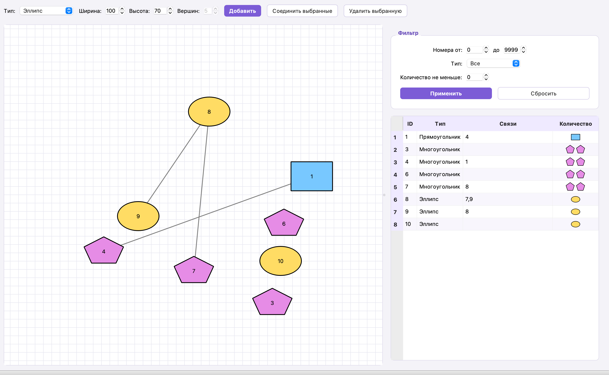
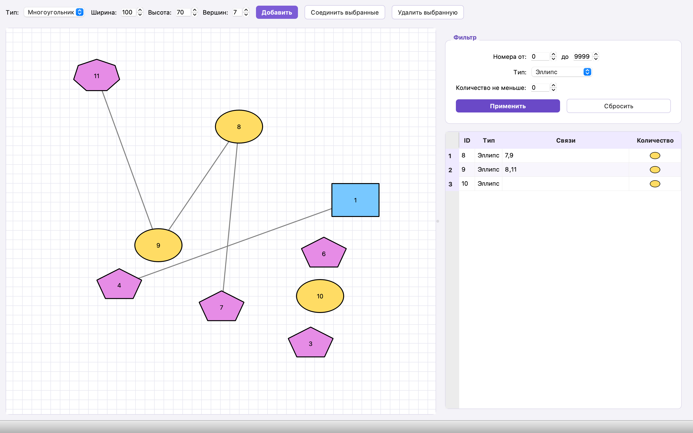
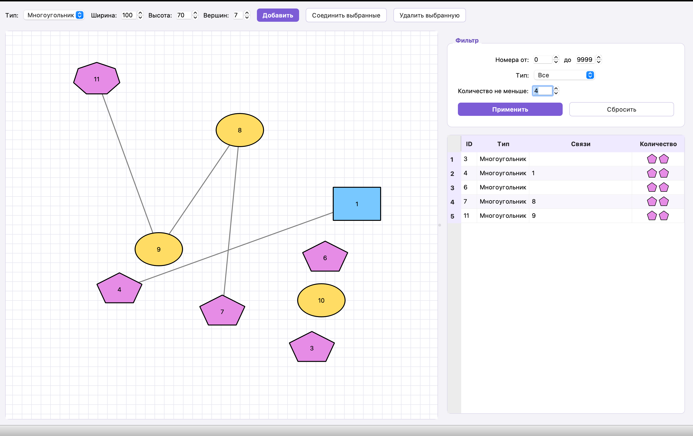

# Редактор фигур (Qt / C++ / SQLite)

Лабораторная работа по ООП: приложение на C++ с графическим фреймворком Qt, в котором на графической сцене создаются фигуры (прямоугольники, эллипсы, многоугольники) и связи между ними. Все фигуры и связи хранятся в базе данных SQLite и отображаются в таблице.

## Возможности

- Добавление фигур трёх типов с заданными размерами (ширина, высота; для многоугольника число вершин от 3 до 12).
- Перемещение и выделение фигур мышью.
- Соединение двух выделенных фигур линией; линии следуют за фигурами при перемещении.
- Хранение фигур и связей в SQLite.
- Отображение базы в таблице (`QSqlTableModel` + `QTableView`): номер, тип, номера связанных фигур, количество фигур такого типа.
- Фильтрация таблицы по диапазону номеров, типу и количеству. Фильтр меняет только отображение, данные в базе не удаляются.
- Удаление выбранной фигуры (из таблицы или с холста) вместе со всеми её связями — на сцене и в базе.
- Делегат в столбце «Количество»: если фигур данного типа 1–3, рисуется одна иконка, 4–10 — две, больше 10 — три.

## Как пользоваться

1. Выберите тип фигуры, задайте размеры и нажмите **«Добавить»**. Фигура появится в случайном месте холста.
2. Чтобы соединить фигуры, выделите две: клик по первой, затем **Cmd+клик** (macOS) или **Ctrl+клик** (Windows/Linux) по второй. Нажмите **«Соединить выбранные»**.
3. Чтобы удалить фигуру, выделите её на холсте или строку в таблице и нажмите **«Удалить выбранную»**.
4. Для фильтрации задайте условия в блоке **«Фильтр»** и нажмите **«Применить»**. **«Сбросить»** снова показывает все записи.

## Сборка и запуск

### Требования

- Qt 5.10 или новее (проверено на Qt 5.14.2), модули `core`, `gui`, `widgets`, `sql`.
- Драйвер SQLite для Qt (`QSQLITE`) — входит в стандартную поставку Qt.
- Компилятор с поддержкой C++11.
- Система сборки — **qmake** (файл проекта `ShapesLab/ShapesLab.pro`).

### Через Qt Creator (любая ОС)

1. **Файл → Открыть файл или проект** → `ShapesLab/ShapesLab.pro`.
2. Выбрать комплект для своей системы (Desktop Qt …).
3. **Сборка → Собрать**, затем **Запустить** (Ctrl+R / Cmd+R).

### Из командной строки

```bash
mkdir build && cd build
qmake ../ShapesLab/ShapesLab.pro
make            
```

### Файл базы данных

База создаётся автоматически при первом запуске — файл `shapes.db` в рабочей папке программы (при запуске из Qt Creator — в папке сборки; на macOS — внутри `ShapesLab.app/Contents/MacOS/`). При каждом запуске база очищается: позиции фигур на холсте не сохраняются, поэтому таблица синхронизируется с текущим сеансом работы.

## Как устроен код

### Фигуры — `Shape` и наследники

- `Shape` — абстрактный базовый класс, наследник `QGraphicsItem`. Хранит номер (`id`), размеры и список подключённых линий. Реализует общее для всех фигур: `boundingRect()`, `paint()` (обводка, заливка, выделение, номер), флаги перемещения и выделения.
- Чисто виртуальные методы `drawShape()`, `fillColor()`, `typeName()`, `shapeType()` переопределяются в наследниках `RectShape`, `EllipseShape`, `PolygonShape`. В `paint()` базового класса вызывается `drawShape()`, и за счёт полиморфизма рисуется форма конкретного наследника.
- `PolygonShape` хранит собственное поле — число вершин — и строит правильный многоугольник, вписанный в размеры фигуры.
- При перемещении фигуры Qt вызывает переопределённый `itemChange()`, и фигура просит все свои линии пересчитать концы.

### Связи — `Connection`

Наследник `QGraphicsLineItem`. Хранит указатели на две фигуры и в `updatePosition()` проводит отрезок между их центрами в координатах сцены. Каждая из двух фигур хранит указатель на линию в своём списке, поэтому линия обновляется при перемещении любого из концов.

### База данных — `ShapeDatabase`

Весь SQL вынесен в отдельный класс.&#32;

- Каждая связь — отдельная строка таблицы `connections`.
- Внешние ключи с `ON DELETE CASCADE`: при удалении фигуры её связи удаляются из базы автоматически.&#32;
- Представление `shapes_view` собирает для каждой фигуры номер, тип, список номеров связанных фигур (через `GROUP_CONCAT`) и количество фигур этого типа. Именно его показывает таблица в окне.
- `total_count` пересчитывается после каждого добавления и удаления запросом `UPDATE ... SET total_count = (SELECT COUNT(*) ...)`.

### Окно — `MainWindow`

Создаёт интерфейс, хранит сцену, словарь «номер - фигура» и объект базы.&#32;

После каждого изменения вызывается `model->select()`, чтобы таблица перечитала данные.

### Делегат — `CountDelegate`

Наследник `QStyledItemDelegate`, назначен на столбец «Количество». В переопределённом `paint()` берёт количество из ячейки и тип из соседней ячейки строки и рисует 1, 2 или 3 иконки фигуры по правилу из задания.

### Демонстрация основных функций приложения:




